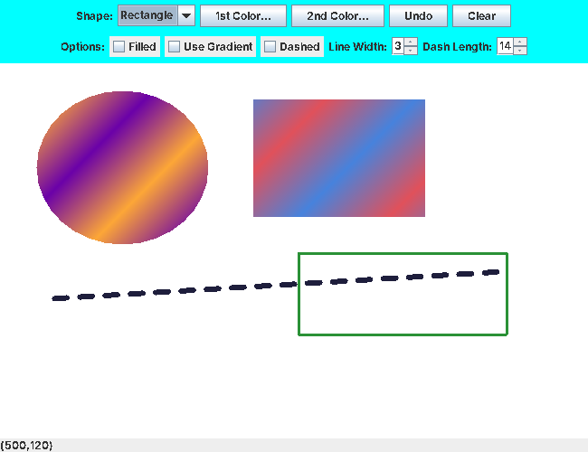

# 2D Drawing Application

A **Java Swing** paint program for drawing lines, ovals and rectangles with gradients, fills, adjustable line widths and dashed strokes, built around an object-oriented **shape hierarchy**.



*Drawn with the app: a gradient-filled oval and rectangle, a thick dashed line and an outlined rectangle.*

## Features

- **Shapes:** line, oval and rectangle, chosen from a drop-down and drawn by clicking and dragging
- **Colours:** two colour pickers (`JColorChooser`) for solid colours or a **two-colour gradient**
- **Options:** filled or outlined, gradient on or off, solid or **dashed** strokes, with spinners for line width and dash length
- **Undo** the last shape, or **Clear** everything
- **Status bar** showing the mouse position on the canvas

## Design

```
            MyShapes (abstract)
            ─ start/end point, Paint, Stroke
            ─ abstract draw(Graphics2D)
              │
      ┌───────┴─────────┐
   MyLine        MyBoundedShapes (abstract)
                 ─ filled flag, bounding-box helpers
                     │
               ┌─────┴─────┐
            MyOval     MyRectangle
```

- **Polymorphism:** every shape is stored in one `ArrayList<MyShapes>`, and the canvas's `paintComponent` calls `draw()` on each, without needing to know which kind of shape it is.
- **Shared geometry:** `MyBoundedShapes` works out the top-left corner, width and height from any two corner points, so ovals and rectangles can be dragged in any direction.
- **Rubber-band drawing:** a mouse handler creates the shape on press, updates its end point while dragging, and repaints, so the shape follows the cursor.
- **Java 2D:** `GradientPaint` for gradients and `BasicStroke` with a dash pattern for dashed lines.

## Known limitation

Set the dash length above 0 before ticking **Dashed**: Java can't draw a dash pattern of length 0, so a zero-length dash shape won't appear.

## Run it

```bash
javac *.java
java DrawingApplication5
```

Remove the `package com.mycompany.drawingapplication5;` lines first, or open the NetBeans project in `drawingapplication5 (1).zip`.

Coursework for a Java object-oriented programming course at Penn State.

## Tools

Java, Swing, Java 2D

---

[Tisya Vaidya](https://tisyavaidya.com) · [LinkedIn](https://www.linkedin.com/in/tisya-vaidya/) · [GitHub](https://github.com/tisyavaidya)
